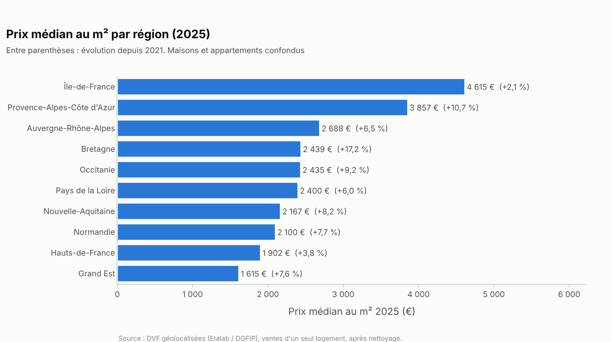
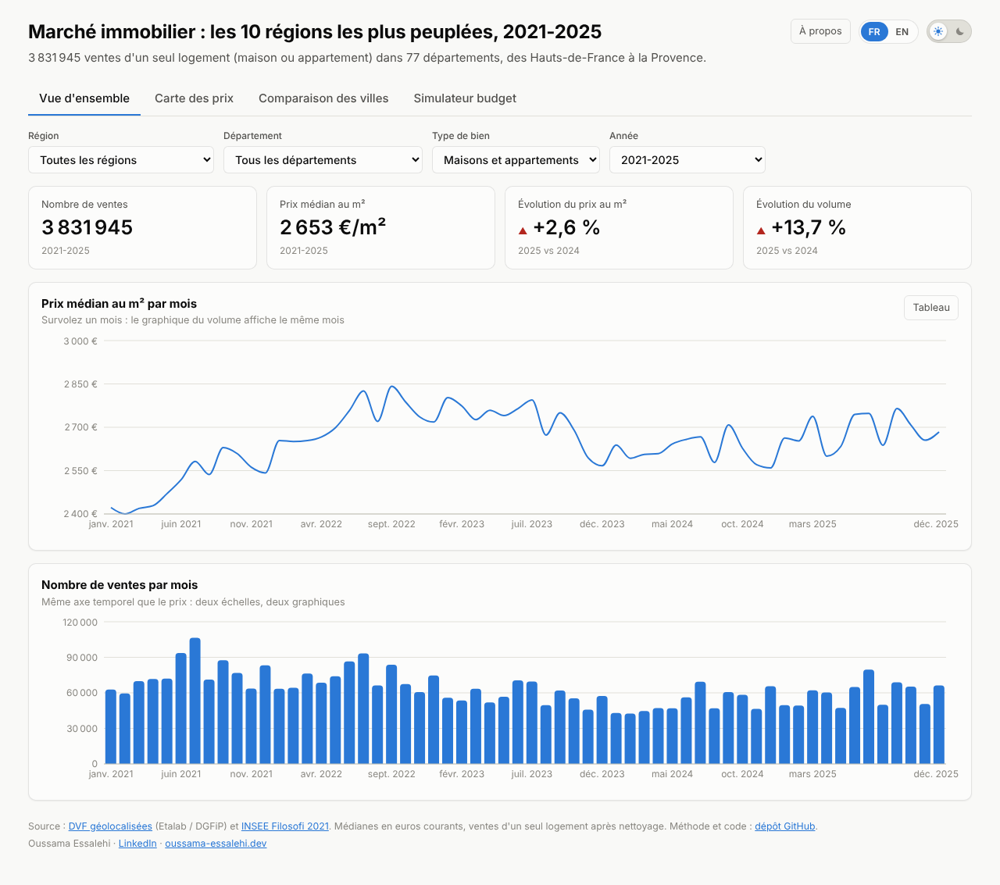
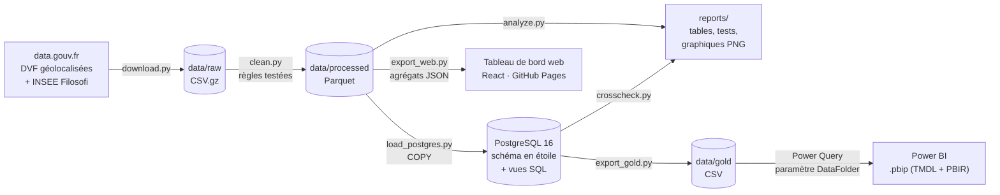

# Analyse du marché immobilier français (DVF) — 2021-2025

**3,8 millions de ventes de logements analysées dans les 10 régions les plus peuplées de France
pour mesurer l'effet de la hausse des taux et identifier où acheter au meilleur prix au m², de
la donnée publique brute jusqu'à un tableau de bord Power BI et un site web.**

**[Ouvrir le tableau de bord web](https://oussama-essalehi.github.io/dvf-immobilier-analyse/)** (aucune installation) · Power BI : [`powerbi/`](powerbi/)

    

## La question métier

Dans le rôle d'un analyste du marché immobilier : **comment les prix ont-ils évolué depuis
2021, la hausse des taux de 2022-2023 a-t-elle freiné le marché, et où peut-on encore acheter
à un prix raisonnable au m² ?**

Périmètre : les 10 régions les plus peuplées (Île-de-France, Auvergne-Rhône-Alpes,
Nouvelle-Aquitaine, Occitanie, Hauts-de-France, Grand Est, Provence-Alpes-Côte d'Azur, Pays de
la Loire, Bretagne, Normandie), soit 77 départements, avec un zoom sur les **30 plus grandes
villes** (classées par population INSEE), toutes les années publiées (2021-2025).

## Constats clés

- **Le marché s'est ajusté par les volumes, pas par les prix** : entre 2021 et 2023, les ventes
  chutent de **25 %** quand le prix médian au m² *augmente* de **8 %** (2 517 € → 2 723 €), et
  ce dans les 10 régions.
- **Creux en 2024, reprise partielle en 2025** : −32 % de ventes en 2024 par rapport à 2021,
  puis +14 % en 2025, encore 22 % sous 2021 ; le prix médian (2 691 €/m²) est en hausse de
  6,9 % sur 4 ans en euros courants.
- **Les régions divergent** : Bretagne **+17,2 %** et Provence-Alpes-Côte d'Azur **+10,7 %**
  depuis 2021, contre **+2,1 %** seulement en Île-de-France.
- **Les grandes métropoles chères corrigent, la Méditerranée monte** : Paris **−10,6 %**,
  Lyon **−11,1 %**, Nantes **−11,5 %**, Bordeaux **−10,2 %** entre 2021 et 2025, contre Nice
  **+14,3 %**, Marseille **+11,8 %** et Brest **+16,0 %** (Mann-Whitney avec correction de
  Bonferroni : 21 évolutions significatives sur 30, d'effet surtout faible).
- **Accessibilité de 1 à 8** : 250 000 € achètent **26 m²** d'appartement à Paris, 56 m² à
  Lyon, 77 m² à Toulouse et **209 m²** à Saint-Étienne ; le logement médian coûte **9,4 années**
  de revenu d'un ménage à Paris contre 2,7 à Saint-Étienne.

Détail chiffré et méthode des tests : [`reports/findings.md`](reports/findings.md).

| Hausse des taux : volume vs prix | Évolution des prix 2021 → 2025 |
|---|---|
|  |  |



**Tableau de bord web** ([version en ligne](https://oussama-essalehi.github.io/dvf-immobilier-analyse/), React) — mêmes 4 pages que le rapport
Power BI, filtres partagés, thème clair / sombre, version française et anglaise, fenêtre de
présentation à la première visite, affichage mobile :

| Vue d'ensemble | Carte des prix |
|---|---|
|  |  |

**Tableau de bord Power BI** (4 pages : vue d'ensemble, carte des prix, comparaison des villes,
simulateur de budget ; segments Région, Département, Type de bien et Année synchronisés) :
projet [`powerbi/`](powerbi/), captures à produire depuis Power BI Desktop
([guide § 7](powerbi/BUILD_GUIDE.md#7-captures-décran-pour-le-readme)).

## Recommandations

1. **Primo-accédant** : viser les grandes villes aux prix stables et au marché profond —
   Toulouse (+1,1 % en 4 ans, 5,6 années de revenu), Lille, Rennes — ou, budget plus serré,
   Grenoble et Clermont-Ferrand (100 à 118 m² pour 250 000 €, 4,3 années de revenu).
2. **Acheteur à Paris, Lyon, Nantes ou Bordeaux** : le rapport de force est favorable (prix −10
   à −11,5 % depuis 2021, volumes encore 7 à 23 % sous 2021) et les prix se stabilisent en 2025
   (de −1,8 % à +1,3 % sur un an) — négocier.
3. **Investisseur** : prudence à Nice, Toulon, Marseille et Brest, où la hausse de 12 à 16 %
   s'est faite avec moins de ventes ; croiser avec une source de loyers, absente de DVF.

## Données et méthode

- **Source** : [DVF géolocalisées](https://www.data.gouv.fr/datasets/demandes-de-valeurs-foncieres-geolocalisees)
  (Etalab, d'après la DGFiP), 385 fichiers (77 départements × 5 ans), 18 millions de lignes ;
  enrichissement [INSEE Filosofi 2021](https://www.insee.fr/fr/statistiques/7756729) (revenus
  et population par commune, qui servent aussi à choisir les 30 plus grandes villes).
- **Le piège des mutations multi-lots** : une vente occupe plusieurs lignes (logement, cave,
  parking, terrain) et son prix total est **répété sur chaque ligne** — additionner les lignes
  surestime les montants d'un facteur 4,6 (année 2024). Le pipeline réduit chaque vente à une ligne, ne
  garde que les ventes d'**un seul logement** (calcul du prix au m² fiable) et compte les
  logements *distincts*, car DVF répète aussi un même logement par nature de culture de sa
  parcelle.
- **Nettoyage** : ventes classiques uniquement, prix et surface renseignés, bornes dures
  (≥ 9 m², ≥ 10 000 €) et percentiles 1-99 du prix au m² par département et type de bien.
  17 979 120 lignes → 3 831 945 ventes, chaque règle testée (`pytest`) et documentée avec ses
  comptages. Les fichiers sont traités département par département pour tenir en mémoire.
- **Statistiques** : médianes, test U de Mann-Whitney 2021 vs 2025 par ville avec correction de
  Bonferroni et taille d'effet ; médianes SQL et Python contrôlées au centime près.

Méthode complète : [`docs/methodology.md`](docs/methodology.md) · Dictionnaire :
[`docs/data_dictionary.md`](docs/data_dictionary.md) · Exploration :
[`notebooks/01_exploration.ipynb`](notebooks/01_exploration.ipynb).

## Architecture



Schéma en étoile : `fact_ventes` (une vente) reliée à `dim_date`, `dim_commune`,
`dim_type_local` et `dim_profil_bien` (dimension fourre-tout des tranches de prix, surface et
pièces). Couche SQL : CTE, `PERCENTILE_CONT`, `GROUPING SETS`, `LAG`, `RANK`, médiane glissante
sur 3 mois via `LATERAL` ([`sql/`](sql/)).

## Stack technique

| Couche | Outils |
|---|---|
| Extraction et nettoyage | Python 3.11+, pandas, NumPy, PyArrow, requests |
| Stockage et SQL | PostgreSQL 16 (Docker), SQLAlchemy 2, psycopg 3 |
| Analyse | SciPy (Mann-Whitney U), Plotly + Kaleido, Jupyter |
| Qualité | pytest (20 tests), Vitest (18 tests), contrôle croisé SQL ↔ Python, validation des schémas Power BI |
| Restitution | Power BI Desktop, projet `.pbip` : modèle TMDL, rapport PBIR, thème personnalisé |
| Web | React 18, TypeScript, Vite, Recharts, Leaflet (OpenStreetMap), Vitest ; interface bilingue FR / EN ; déploiement GitHub Pages par GitHub Actions |
| Orchestration | `run.py` (multiplateforme) et `Makefile`, configuration dans `config.yaml` |

## Lancer le projet

Prérequis : Python 3.11+, Docker Desktop, Google Chrome ou Chromium (export PNG des graphiques).

```bash
git clone https://github.com/Oussama-essalehi/dvf-immobilier-analyse.git
cd dvf-immobilier-analyse
python -m venv .venv && .venv\Scripts\activate      # Linux / macOS : source .venv/bin/activate
pip install -r requirements.txt

python run.py all        # ou : make all
```

`all` démarre PostgreSQL (`docker compose up -d --wait`), télécharge les données, nettoie,
charge la base, produit les analyses et les graphiques, exporte `data/gold/`, contrôle les
médianes SQL ↔ Python et lance les tests (20 à 30 minutes selon la connexion : environ 475 Mo
à télécharger, 3,8 millions de ventes à charger). Étapes unitaires :
`download`, `clean`, `load`, `analyze`, `export`, `export-web`, `check`, `test`, `notebook`,
`validate-pbi`. Le périmètre (régions et départements, années, nombre de villes, seuils) se
règle dans
[`config.yaml`](config.yaml).

**Power BI** (Windows) :

1. Ouvrir `powerbi/DVF_Analyse.pbip` dans Power BI Desktop.
2. *Accueil > Transformer les données > Modifier les paramètres* : renseigner `DataFolder`
   avec le chemin absolu de `data\gold\` (terminé par `\`).
3. *Actualiser*. Les CSV de `data/gold/` ne sont pas versionnés (`fact_ventes.csv` dépasse
   la limite de taille de GitHub) : les produire d'abord avec `python run.py all`.

Pas à pas complet, valeurs de contrôle et reconstruction de chaque visuel :
[`powerbi/BUILD_GUIDE.md`](powerbi/BUILD_GUIDE.md).

**Tableau de bord web** (Node.js 20+) :

```bash
cd web
npm install
npm run dev        # http://localhost:5173
npm test           # tests des sélecteurs et du formatage
npm run build      # version statique dans web/dist
```

Les données du site (`web/public/data/*.json`, environ 3 Mo) sont des agrégats produits par
`python run.py export-web` : chaque combinaison de filtres a sa médiane exacte, calculée en
Python, donc identique aux analyses et au rapport Power BI. Les communes sont réparties en un
fichier par région, téléchargé seulement quand la région est choisie sur la carte. Le workflow
[`.github/workflows/deploy-web.yml`](.github/workflows/deploy-web.yml) teste, construit et
publie le site sur GitHub Pages à chaque push sur `main` (à activer une fois : *Settings >
Pages > Source : GitHub Actions*).

## Limites

- **Couverture** : DVF n'inclut ni l'Alsace-Moselle (Bas-Rhin, Haut-Rhin, Moselle, régime du
  livre foncier) ni Mayotte : le Grand Est est donc représenté par 7 de ses 10 départements.
- **Périmètre** : 10 régions sur 13 en métropole ; Centre-Val de Loire,
  Bourgogne-Franche-Comté, la Corse et l'outre-mer ne sont pas analysés.
- **Biais du filtre « un seul logement »** : les ventes en bloc (235 634 mutations) et le neuf
  vendu sur plan (VEFA) sont exclus ; les résultats décrivent le marché de l'ancien à l'unité.
- **Prix déclarés** : la valeur foncière est le prix inscrit à l'acte, en euros courants (non
  corrigés de l'inflation).
- **Pas d'information sur l'état du bien** : ni travaux, ni DPE, ni étage, ni exposition ; une
  part des écarts de prix entre villes reflète des parcs de logements différents.
- **Revenus** : INSEE Filosofi 2021, revenu du ménage estimé (médiane par unité de consommation
  × taille moyenne des ménages).

## Contact

**Oussama Essalehi** — Data Analyst

- LinkedIn : [linkedin.com/in/oussama-essalehi](https://www.linkedin.com/in/oussama-essalehi)
- Site : [oussama-essalehi.dev](https://oussama-essalehi.dev)
