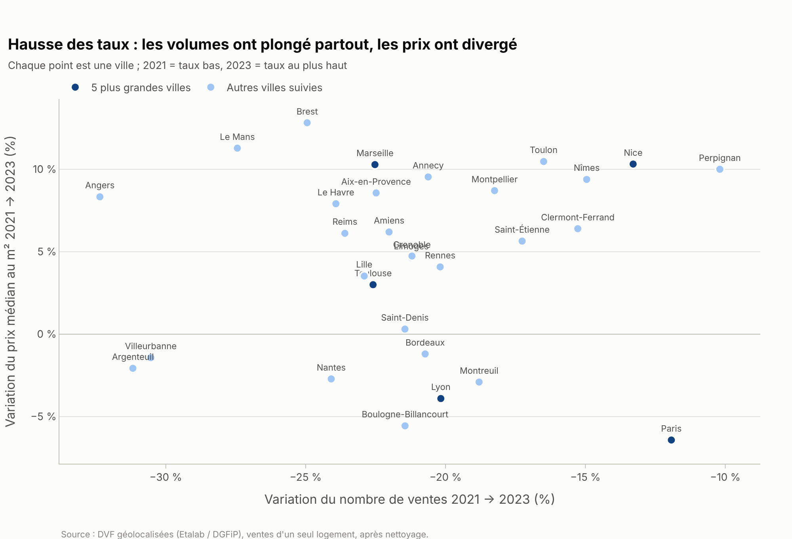
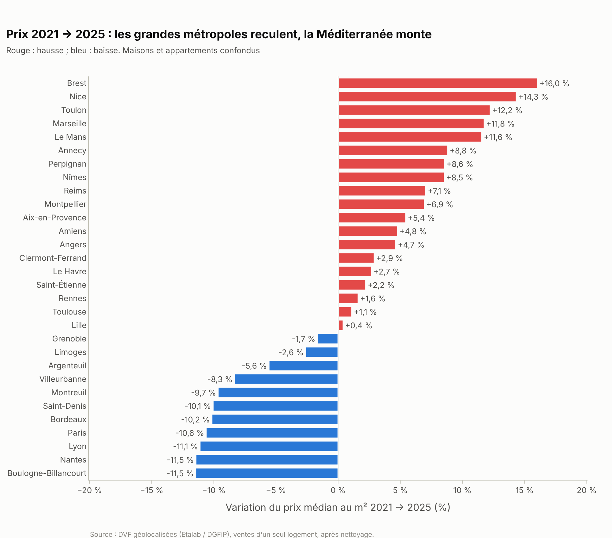
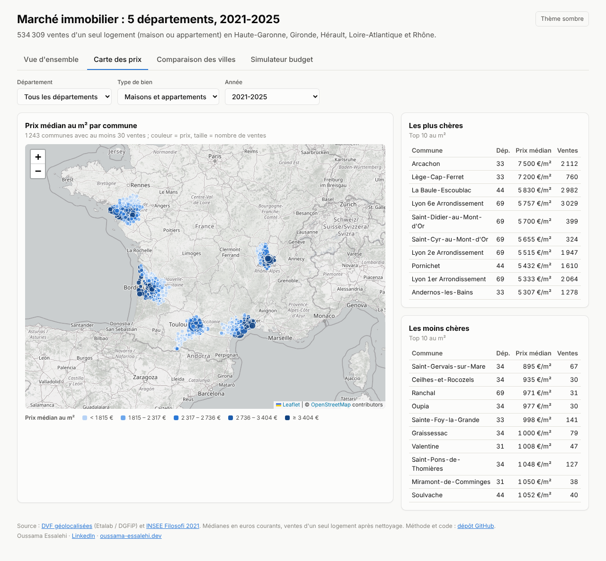

# Immoscope France — le marché immobilier français, 2021-2025

**3,8 millions de ventes immobilières analysées dans les 10 régions les plus peuplées de France,
de la donnée publique brute jusqu'à un tableau de bord en ligne.**

### [Voir le tableau de bord en ligne → immoscope-france.vercel.app](https://immoscope-france.vercel.app/)

[](https://github.com/Oussama-essalehi/immoscope-france/actions/workflows/ci.yml)    

## La question

**Comment les prix ont-ils évolué depuis 2021, la hausse des taux a-t-elle freiné le marché,
et où peut-on encore acheter à un prix raisonnable au m² ?**

## Résultats clés

- **Le marché s'est ajusté par les volumes, pas par les prix** : entre 2021 et 2023, les ventes
  chutent de **25 %** quand le prix médian au m² *augmente* de **8 %**, dans les 10 régions.
- **Les grandes métropoles corrigent, la Méditerranée monte** : Paris **−10,6 %**, Lyon
  **−11,1 %**, Bordeaux **−10,2 %** entre 2021 et 2025, contre Nice **+14,3 %** et Marseille
  **+11,8 %**.
- **Les régions divergent** : Bretagne **+17,2 %**, Île-de-France **+2,1 %** seulement.
- **Accessibilité de 1 à 8** : 250 000 € achètent **26 m²** à Paris contre **209 m²** à
  Saint-Étienne.

| Hausse des taux : volume vs prix | Évolution des prix 2021 → 2025 |
|---|---|
|  |  |



Constats détaillés et recommandations : [`reports/findings.md`](reports/findings.md).

## Ce que j'ai réalisé

- **Pipeline de données** (Python, pandas) : téléchargement de 385 fichiers publics DVF
  (18 millions de lignes), nettoyage testé et documenté jusqu'à 3,8 millions de ventes fiables.
  Principal piège traité : le prix d'une vente est répété sur chaque ligne du fichier.
- **Base de données** (PostgreSQL, Docker) : schéma en étoile et requêtes SQL d'analyse
  (fonctions de fenêtre, médianes, `GROUPING SETS`).
- **Statistiques** : tests de Mann-Whitney avec correction de Bonferroni et tailles d'effet ;
  médianes SQL et Python contrôlées au centime.
- **Restitution** : tableau de bord **Power BI** de 4 pages (modèle en étoile, mesures DAX,
  simulateur de budget) et **site web React** bilingue avec carte interactive.

| Domaine | Outils |
|---|---|
| Données et analyse | Python, pandas, SciPy, Plotly, Jupyter |
| Base de données | PostgreSQL 16, SQL, Docker |
| Visualisation | Power BI (DAX, Power Query), React, TypeScript, Leaflet |
| Qualité | pytest, Vitest, contrôle croisé SQL ↔ Python |

## Données

[DVF géolocalisées](https://www.data.gouv.fr/datasets/demandes-de-valeurs-foncieres-geolocalisees)
(Etalab / DGFiP) et [INSEE Filosofi 2021](https://www.insee.fr/fr/statistiques/7756729)
(revenus et population par commune).

Pour aller plus loin : [méthodologie](docs/methodology.md) ·
[notebook d'exploration](notebooks/01_exploration.ipynb) ·
[projet Power BI](powerbi/BUILD_GUIDE.md).

## Lancer le projet

```bash
git clone https://github.com/Oussama-essalehi/immoscope-france.git
cd immoscope-france
pip install -r requirements.txt
python run.py all        # télécharge, nettoie, charge PostgreSQL et produit les analyses
```

Prérequis : Python 3.11+, Docker et Chrome (export des graphiques). Le pipeline complet prend 20 à 30 minutes.

## Contact

**Oussama Essalehi** — Data Analyst ·
[LinkedIn](https://www.linkedin.com/in/oussama-essalehi) ·
[oussama-essalehi.dev](https://oussama-essalehi.dev)
